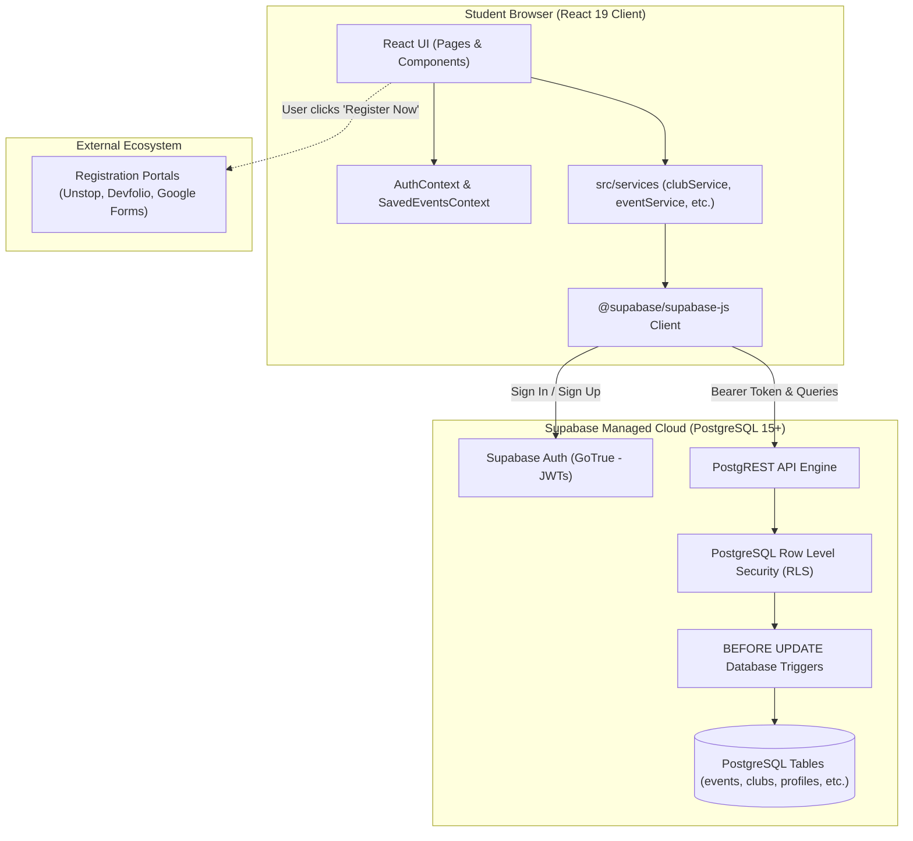
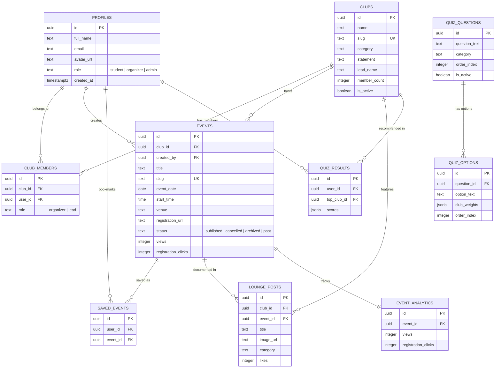
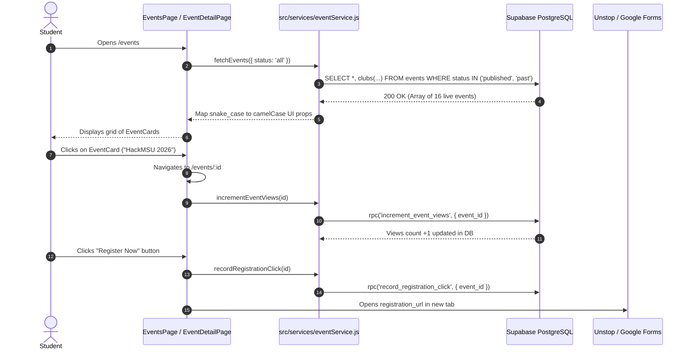

# CampusBuzz — Complete Project Master Documentation & Architecture Guide

> **Audience**: Full-stack developers, beginners, and students onboarding to the CampusBuzz codebase.  
> **Status**: Verified from codebase inspection and live PostgreSQL testing.  
> **Repository Path**: `C:\Users\01\OneDrive\Desktop\CampusBuzz`

---

## Table of Contents

1. [Section 1 — Project Overview](#section-1--project-overview)
2. [Section 2 — Technology Stack](#section-2--technology-stack)
3. [Section 3 — Complete Folder Structure](#section-3--complete-folder-structure)
4. [Section 4 — Application Architecture](#section-4--application-architecture)
5. [Section 5 — Frontend Deep Dive](#section-5--frontend-deep-dive)
6. [Section 6 — Backend Deep Dive](#section-6--backend-deep-dive)
7. [Section 7 — Database and Data Model](#section-7--database-and-data-model)
8. [Section 8 — End-to-End Data Flow](#section-8--end-to-end-data-flow)
9. [Section 9 — Code Connection Map](#section-9--code-connection-map)
10. [Section 10 — Authentication and Security](#section-10--authentication-and-security)
11. [Section 11 — External Services and Integrations](#section-11--external-services-and-integrations)
12. [Section 12 — Environment Configuration](#section-12--environment-configuration)
13. [Section 13 — How to Run the Project](#section-13--how-to-run-the-project)
14. [Section 14 — Deployment and Production Flow](#section-14--deployment-and-production-flow)
15. [Section 15 — Testing and Reliability](#section-15--testing-and-reliability)
16. [Section 16 — Current Implementation Status](#section-16--current-implementation-status)
17. [Section 17 — Issues, Risks, and Technical Debt](#section-17--issues-risks-and-technical-debt)
18. [Section 18 — Beginner's Learning Guide](#section-18--beginners-learning-guide)
19. [Section 19 — Glossary](#section-19--glossary)
20. [Section 20 — Final Project Summary](#section-20--final-project-summary)

---

## Section 1 — Project Overview

### 1.1 What is CampusBuzz?
**CampusBuzz** is a centralized student event discovery and club publishing platform built specifically for the student and faculty ecosystem of the **Faculty of Technology & Engineering (FTE), Maharaja Sayajirao University of Baroda (MSU Baroda)** in Vadodara, Gujarat, India.

Its core motto is:  
> *"Every CSE Event. One Campus."*

### 1.2 The Problem it Solves
Prior to CampusBuzz, announcements for collegiate hackathons, competitive programming contests, workshops, and cultural fests at MSU Baroda were fragmented across:
- Unofficial WhatsApp groups (where messages are quickly buried and hard to search).
- Ephemeral Instagram stories and reels (which vanish after 24 hours).
- Physical paper posters taped on departmental notice boards.
- Individual, isolated club websites that students rarely checked regularly.

Students routinely missed registration deadlines, and departmental student clubs struggled to gain cross-branch attendance. CampusBuzz replaces this chaos with a single, modern, live digital bulletin board, interactive calendar, club directory, and algorithmic recommendation quiz.

### 1.3 What CampusBuzz IS vs What it is NOT

| What CampusBuzz IS | What CampusBuzz IS NOT |
| :--- | :--- |
| Centralized event feed with multi-facet filters (Coding, Robotics, Culture, Workshops). | It is **NOT** an administrative ERP or grading system (like Moodle/Canvas). |
| Interactive month-view calendar showing all campus happenings. | It is **NOT** a classroom attendance tracking system. |
| Student club directory profiling leads, social links, and event archives. | It is **NOT** a payment gateway (no credit cards or tickets sold internally). |
| "Club Fit Quiz" matching student skills with campus societies. | It is **NOT** a replacement for club Instagrams (it links out to them). |
| Lightweight publishing dashboard for verified student club heads. | It is **NOT** a social network with direct messaging or chat rooms. |

### 1.4 Primary User Roles

The platform implements 3 distinct roles governed by database Row Level Security:

1. **Student (General User)**:
   - Discovers upcoming events, filters by category/club, searches keywords.
   - Views interactive monthly calendar and clicks to sync or view details.
   - Takes the 5-question Club Recommendation Quiz to find compatible societies.
   - Bookmarks events into a personal "Saved Events" collection.
   - Browses photo moments in the Campus Lounge.
   - Redirects to external registration links (e.g. Unstop, Google Forms, Devfolio).
2. **Club Head / Organizer**:
   - Represents an officially chartered student club (e.g., VIMARSH, Dev Infinity).
   - Manages events hosted by their assigned club society.
   - Publishes new events with dates, posters, venues, and registration URLs.
   - Updates event details or archives past sessions.
   - Uploads photo captures to the Campus Lounge gallery.
3. **Faculty / Administrator**:
   - Holds master governance rights across the entire institution.
   - Assigns club ownership to students, promoting them from Student to Club Head.
   - Revokes unauthorized events or inappropriate lounge photos.
   - Monitors institutional analytics (total events, member numbers, engagement).

---

## Section 2 — Technology Stack

All dependencies were verified directly from `package.json`, `server/package.json`, and lockfiles.

| Technology | Verified Version | Purpose in this Project | Where it is Used |
| :--- | :--- | :--- | :--- |
| **JavaScript (ES Modules)** | ES2022+ | Primary programming language | Entire codebase (`src/` and `server/`) |
| **React** | `19.2.8` | Declarative UI component library | Frontend view layer (`src/`) |
| **Vite** | `8.3.0` | Fast build tool & Hot Module Replacement (HMR) server | Development server & production bundler |
| **React Router DOM** | `7.18.4` | Client-side routing, navigation, & protected routes | `src/App.jsx`, page routing |
| **Tailwind CSS** | `3.4.x` | Utility-first styling & custom dark theme | UI components, `tailwind.config.js`, `src/index.css` |
| **Framer Motion** | `14.0.0` | Micro-animations, page transitions, modal reveals | Dynamic cards and animated UI elements |
| **Lucide React** | `1.52.0` | Consistent iconography across the application | Icons in buttons, navbar, cards, badges |
| **Canvas Confetti** | `1.9.4` | Celebration confetti explosion effect | `src/pages/Quiz/QuizPage.jsx` on quiz completion |
| **clsx / tailwind-merge** | `2.1.1 / 3.7.0` | Dynamic CSS class composition utility | Styling helpers |
| **Supabase JS Client** | `2.109.0` (client) / `2.49.1` (server) | Official client SDK for Supabase PostgreSQL & Auth | `src/lib/supabaseClient.js`, `src/services/` |
| **PostgreSQL** | `15+` | Relational database engine hosted on Supabase | Database layer (`supabase/schema.sql`) |
| **Node.js** | `v20.20.2` | JavaScript runtime environment | Server & build execution |
| **Express** | `4.21.2` | Optional Node.js HTTP REST API framework | `server/src/app.js` (Phase 2 backend microservice) |
| **CORS** | `2.8.5` | Cross-Origin Resource Sharing middleware | `server/src/app.js` |
| **dotenv** | `16.4.7` | Environment variable loader | `server/src/config/supabase.js` |
| **ws** | `8.22.0` | WebSocket transport support for realtime connections | `server/src/config/supabase.js` |
| **Oxlint** | `1.81.0` | High-performance linter | `package.json` lint script |

---

## Section 3 — Complete Folder Structure

Below is the repository structure, highlighting the purpose and architectural role of every key directory:

```text
CampusBuzz/
│
├── .env.example                     # Environment template (NO SECRETS) containing variable names
├── .env.local                       # Local secret credentials (git-ignored, holds Supabase keys)
├── .gitignore                       # Git ignore configuration protecting node_modules & .env files
├── .oxlintrc.json                   # Linter rule definitions for code quality checks
├── GEMINI.md                        # Permanent project architecture guide and chronological change log
├── index.html                       # Single Page Application HTML5 entry point with Google Fonts
├── package.json                     # Root npm manifest (scripts, React 19 dependencies)
├── package-lock.json                # Deterministic dependency lockfile for npm
├── postcss.config.js                # PostCSS configuration integrating Tailwind CSS & Autoprefixer
├── PROJECT_MASTER_DOCUMENTATION.md  # THIS MASTER DOCUMENTATION FILE
├── README.md                        # Quick-start documentation and project overview
├── tailwind.config.js               # Theme configuration (custom dark palette, campus-950 tokens)
├── vite.config.js                   # Vite frontend configuration
│
├── docs/                            # High-Level Architecture Documentation
│   ├── api.md                       # Express API endpoint definitions
│   ├── architecture.md              # System architecture overview & query patterns
│   └── database.md                  # Database entity relationship summary
│
├── public/                          # Static Assets Served Directly at Root
│   ├── favicon.svg                  # CampusBuzz tab icon
│   └── icons.svg                    # SVG sprite symbols
│
├── server/                          # Optional Node.js / Express Microservice Backend
│   ├── package.json                 # Express server dependencies (express, cors, dotenv)
│   ├── package-lock.json            # Server dependency lockfile
│   └── src/
│       ├── app.js                   # Express app setup, CORS, route mounting, error handlers
│       ├── server.js                # HTTP listener starting Express on port 5000
│       ├── config/
│       │   └── supabase.js          # Server-side Supabase client initialization
│       ├── controllers/
│       │   ├── analyticsController.js # Event view and registration click handlers
│       │   ├── eventController.js   # Event CRUD operations
│       │   └── quizController.js    # Recommendation calculation endpoint
│       ├── middleware/
│       │   └── auth.js              # requireAuth, requireRole, requireClubOwnership middlewares
│       ├── routes/
│       │   ├── analyticsRoutes.js   # /api/analytics route definitions
│       │   ├── eventRoutes.js       # /api/events route definitions
│       │   └── quizRoutes.js        # /api/quiz route definitions
│       └── validators/
│           └── eventValidator.js    # Payload sanitization and field validation
│
├── src/                             # React Frontend Source Code
│   ├── main.jsx                     # Application bootstrap mounting React DOM into #root
│   ├── App.jsx                      # Client router root, AuthProvider & SavedEventsProvider
│   ├── App.css                      # Global layout styles
│   ├── index.css                    # Tailwind directives, dark scrollbars, glassmorphism tokens
│   │
│   ├── assets/                      # Static UI Images & SVGs
│   │   ├── hero.png                 # Hero section backdrop illustration
│   │   ├── react.svg                # React logo asset
│   │   └── vite.svg                 # Vite logo asset
│   │
│   ├── components/                  # Reusable UI Primitives
│   │   ├── clubs/
│   │   │   └── ClubCard.jsx         # Card preview displaying club logo, statement, domain
│   │   ├── common/
│   │   │   ├── Badge.jsx            # Category and status pill indicators
│   │   │   ├── Button.jsx           # Variant buttons (primary, secondary, outline, danger)
│   │   │   ├── EmptyState.jsx       # Zero-result placeholder with call to action
│   │   │   ├── LoadingSkeleton.jsx  # Shimmer loading placeholders for cards and text
│   │   │   ├── Logo.jsx             # Gradient logo mark with typography
│   │   │   └── ProtectedRoute.jsx   # Role-based route guard redirecting unauthorized access
│   │   ├── events/
│   │   │   └── EventCard.jsx        # Rich event card (poster, date, tags, bookmark button, views)
│   │   └── layout/
│   │       ├── Footer.jsx           # Clean department branding, copyright, and quick links
│   │       ├── Layout.jsx           # Master layout shell wrapping pages with Navbar and Footer
│   │       └── Navbar.jsx           # Sticky glassmorphism header with navigation, auth controls
│   │
│   ├── context/                     # React Context State Providers
│   │   ├── AuthContext.jsx          # Supabase auth session, user profile, role state, and demo switcher
│   │   └── SavedEventsContext.jsx   # Bookmark state synchronized with localStorage & Supabase
│   │
│   ├── data/                        # High-Fidelity Mock & Fallback Datasets
│   │   ├── mockClubs.js             # 5 core MSU Baroda clubs fallback data
│   │   ├── mockEvents.js            # 16 comprehensive mock events (published & past)
│   │   ├── mockLounge.js            # Campus lounge images and metadata
│   │   └── mockQuiz.js              # 5-step quiz questions with club weight vectors
│   │
│   ├── lib/
│   │   └── supabaseClient.js        # Supabase client instantiation with fallback detection
│   │
│   ├── pages/                       # Application Routed Views
│   │   ├── Admin/
│   │   │   └── AdminDashboardPage.jsx # Master governance panel: user role promotion & club linking
│   │   ├── Auth/
│   │   │   ├── LoginPage.jsx        # Email/password authentication form with demo accounts
│   │   │   └── SignupPage.jsx       # Registration form with department and batch selection
│   │   ├── Calendar/
│   │   │   └── CalendarPage.jsx     # Interactive month-view calendar with day event pills
│   │   ├── Clubs/
│   │   │   ├── ClubsPage.jsx        # Clubs directory with domain filters and search
│   │   │   └── ClubDetailPage.jsx   # Club profile, lead info, social handles, and club event list
│   │   ├── Events/
│   │   │   ├── EventsPage.jsx       # Event feed with search, category tabs, and status toggles
│   │   │   └── EventDetailPage.jsx  # Deep-dive view with venue, deadline, view counter, registration
│   │   ├── Home/
│   │   │   └── HomePage.jsx         # Landing hero, live stats, featured events, quiz CTA, clubs
│   │   ├── Lounge/
│   │   │   └── LoungePage.jsx       # Campus photo gallery with category filter and modal preview
│   │   ├── Organizer/
│   │   │   ├── CreateEventPage.jsx  # Event creation and editing form with live validation
│   │   │   └── OrganizerDashboardPage.jsx # Club stats, event management table, status toggles
│   │   ├── Profile/
│   │   │   └── ProfilePage.jsx      # User profile view with name editing and password update
│   │   ├── Quiz/
│   │   │   └── QuizPage.jsx         # 5-step interactive recommendation quiz with confetti
│   │   ├── Saved/
│   │   │   └── SavedEventsPage.jsx  # Personal collection of bookmarked events
│   │   └── NotFoundPage.jsx         # 404 error page with navigation back to Home
│   │
│   └── services/                    # Dual-Mode Data Access Layer (Supabase -> Mock fallback)
│       ├── adminService.js          # User role promotion, demotion, and club reassignment
│       ├── clubService.js           # Club listing, detail by slug, member retrieval
│       ├── eventService.js          # Event filtering, search, detail, view increment, CRUD
│       ├── loungeService.js         # Campus lounge gallery posts, likes, uploads
│       ├── quizService.js           # Quiz questions, options, result persistence
│       └── savedEventService.js     # User saved bookmarks service
│
└── supabase/                        # Database Assets & SQL Migrations
    ├── schema.sql                   # MASTER PRODUCTION SQL (Schema + Functions + Triggers + RLS + Seed)
    └── migrations/
        ├── 001_initial_schema.sql   # Tables and constraints
        ├── 002_rls_policies.sql     # RLS policies and helper functions
        └── 003_seed_data.sql        # 5 clubs, 16 events, quiz, lounge seed data
```

---

## Section 4 — Application Architecture

### 4.1 Client-Direct Architecture (Current MVP Pattern)
In the current CampusBuzz application, the React frontend interacts **directly** with Supabase over HTTPS (PostgREST + GoTrue Auth). It does not need the Express backend running to execute any user flow.



### 4.2 Role of the Express Backend (`server/`)
The `server/` directory contains an Express 4 REST API. As verified by our inspection:
- It was architected during Phase 2 as an optional private API gateway.
- It contains working routes (`/api/events`, `/api/quiz`, `/api/analytics`) and authorization middleware (`requireAuth`, `requireRole`, `requireClubOwnership`).
- **Current Connection**: The React frontend currently talks **directly to Supabase** and does not call `/api/*`. The Express backend remains ready as an optional standalone microservice if future institutional requirements require custom server-side tasks (e.g. LDAP SSO or automated email newsletters).

---

## Section 5 — Frontend Deep Dive

### 5.1 Bootstrap and Root Setup
- Entrypoint: [src/main.jsx](file:///c:/Users/01/OneDrive/Desktop/CampusBuzz/src/main.jsx)
- Mounting Element: `<div id="root"></div>` in [index.html](file:///c:/Users/01/OneDrive/Desktop/CampusBuzz/index.html).
- Providers: [src/App.jsx](file:///c:/Users/01/OneDrive/Desktop/CampusBuzz/src/App.jsx) wraps the application inside:
  1. `<BrowserRouter>` (React Router DOM)
  2. `<AuthProvider>` (Global authentication & session sync)
  3. `<SavedEventsProvider>` (User bookmarks sync)
  4. `<ScrollToTop>` (Ensures navigation resets window scroll to (0,0))

### 5.2 Application Routing Table

| URL Path | Component | Auth Requirement | Purpose |
| :--- | :--- | :--- | :--- |
| `/` | `HomePage` | Public | Hero banner, live stats, featured events, quiz teaser, club showcase. |
| `/events` | `EventsPage` | Public | Searchable event catalog with category, date, and club filters. |
| `/events/:id` | `EventDetailPage` | Public | Deep dive into an event, venue, deadline, view counter, external registration link. |
| `/calendar` | `CalendarPage` | Public | Interactive month-grid calendar with day-specific event badges and detail drawer. |
| `/clubs` | `ClubsPage` | Public | Directory of all 5 core clubs with category filters and search. |
| `/clubs/:id` | `ClubDetailPage` | Public | Club profile, lead contact, social links, upcoming events, past archives, and lounge photos. |
| `/quiz` | `QuizPage` | Public | 5-step questionnaire matching student interests with clubs; triggers confetti. |
| `/saved` | `SavedEventsPage` | Public / Student | Personal collection of bookmarked events. |
| `/lounge` | `LoungePage` | Public | Campus photo gallery with category filters and image modal lightbox. |
| `/login` | `LoginPage` | Public | Email/password sign-in form with one-click demo user switchers. |
| `/signup` | `SignupPage` | Public | New account registration capturing department and graduation year. |
| `/profile` | `ProfilePage` | Authenticated | User account info, name modification, and password update form. |
| `/organizer` | `OrganizerDashboardPage` | Organizer / Admin | Club management console: event listing, active status toggles, metrics. |
| `/organizer/create-event` | `CreateEventPage` | Organizer / Admin | Multi-step form with live validation to publish new events. |
| `/organizer/edit-event/:id` | `CreateEventPage` | Organizer / Admin | Edit existing event details. |
| `/admin` | `AdminDashboardPage` | Admin Only | Master institutional console: promote users to Club Head, reassign clubs. |
| `*` | `NotFoundPage` | Public | 404 fallback page. |

### 5.3 Route Protection with `ProtectedRoute.jsx`
[src/components/common/ProtectedRoute.jsx](file:///c:/Users/01/OneDrive/Desktop/CampusBuzz/src/components/common/ProtectedRoute.jsx) guards routes:
```javascript
// If user is not logged in, redirect to login with redirect path
if (!user) return <Navigate to="/login" state={{ from: location }} replace />;

// If specific roles required, check user.role
if (allowedRoles.length > 0 && !allowedRoles.includes(user.role)) {
  return <Navigate to="/" replace />;
}
```

---

## Section 6 — Backend Deep Dive

The Express server lives in `server/` and listens on port 5000:

### 6.1 Server Startup and Middleware Pipeline
- Entrypoint: [server/src/server.js](file:///c:/Users/01/OneDrive/Desktop/CampusBuzz/server/src/server.js) -> loads [server/src/app.js](file:///c:/Users/01/OneDrive/Desktop/CampusBuzz/server/src/app.js).
- Middleware Order:
  1. `cors()`: Configured to accept cross-origin requests.
  2. `express.json()`: Parses incoming JSON request bodies.
  3. Route Mounts: `/api/events`, `/api/quiz`, `/api/analytics`.
  4. 404 Handler: Catches unmatched routes.
  5. Global Error Handler: Formats unhandled exceptions into structured JSON.

### 6.2 Express Endpoint Catalog

| Method | Endpoint | Auth Required | Controller Handler | Purpose |
| :--- | :--- | :--- | :--- | :--- |
| `GET` | `/api/health` | None | Inline | Server heartbeat check |
| `GET` | `/api/events` | None | `listEvents` | Fetch filtered event lists |
| `GET` | `/api/events/:id` | None | `getEventById` | Fetch single event and increments view |
| `POST` | `/api/events` | `requireAuth` + `organizer/admin` + `requireClubOwnership` | `createEvent` | Validate input & insert event |
| `PATCH` | `/api/events/:id` | `requireAuth` + `organizer/admin` + `requireClubOwnership` | `updateEvent` | Update event fields |
| `DELETE` | `/api/events/:id` | `requireAuth` + `organizer/admin` + `requireClubOwnership` | `deleteEvent` | Remove event |
| `POST` | `/api/quiz/recommend` | None | `recommendClubs` | Compute top matching club from answers |
| `GET` | `/api/analytics/events/:id` | None | `getEventAnalytics` | Fetch views, clicks, and bookmark counts |
| `POST` | `/api/analytics/events/:id/click` | None | `recordRegistrationClick` | Atomically increment registration clicks |

---

## Section 7 — Database and Data Model

The database schema is defined in [supabase/schema.sql](file:///c:/Users/01/OneDrive/Desktop/CampusBuzz/supabase/schema.sql) and contains **10 tables** with strict constraints and Row Level Security.

### 7.1 Entity-Relationship (ER) Diagram



### 7.2 Database Security Features
1. **Helper Function `get_my_role()`**:
   - Marked `SECURITY DEFINER`, `STABLE`, with `SET search_path = public`.
   - Returns the role of `auth.uid()` directly.
   - **Crucial Purpose**: Prevents recursive policy checks on `profiles`.
2. **Trigger `tr_protect_profile_role`**:
   - `BEFORE UPDATE` on `public.profiles`.
   - If `NEW.role != OLD.role` and `NOT is_admin()`, it immediately throws:  
     `'Unauthorized: only administrators can change user roles.'`
3. **Trigger `tr_protect_event_club_assignment`**:
   - Prevents an organizer from modifying an event's `club_id` to steal or transfer events across clubs.
4. **RPC Functions**:
   - `increment_event_views(event_id UUID)` and `record_registration_click(event_id UUID)`: Allow public anonymous incrementing without granting write permissions on the `events` table.

---

## Section 8 — End-to-End Data Flow

### Major Journey: Student Discovers Event and Clicks "Register"



---

## Section 9 — Code Connection Map

This table shows the most important file-to-file relationships across the application:

| Starting File | Calls / Imports | Purpose | Evidence |
| :--- | :--- | :--- | :--- |
| `src/main.jsx` | `src/App.jsx` | Mounts root component into DOM | Lines 9-11 in `main.jsx` |
| `src/App.jsx` | `src/context/AuthContext.jsx` | Wraps application with authentication state | Line 28 in `App.jsx` |
| `src/App.jsx` | `src/context/SavedEventsContext.jsx` | Wraps application with bookmark state | Line 29 in `App.jsx` |
| `src/context/AuthContext.jsx` | `src/lib/supabaseClient.js` | Listens to `auth.onAuthStateChange` & queries `profiles` | Lines 54-85 in `AuthContext.jsx` |
| `src/pages/Events/EventsPage.jsx` | `src/services/eventService.js` | Calls `fetchEvents()` on mount & search changes | Lines 45-56 in `EventsPage.jsx` |
| `src/services/eventService.js` | `src/lib/supabaseClient.js` | Runs `supabase.from('events').select()` | Lines 10-25 in `eventService.js` |
| `src/pages/Admin/AdminDashboardPage.jsx` | `src/services/adminService.js` | Promotes user to Club Head via `promoteToClubHead()` | Lines 72-88 in `AdminDashboardPage.jsx` |
| `src/services/adminService.js` | `src/lib/supabaseClient.js` | Updates `profiles.role` & inserts into `club_members` | Lines 87-105 in `adminService.js` |
| `src/pages/Quiz/QuizPage.jsx` | `src/services/quizService.js` | Reads quiz questions & persists quiz result | Lines 40-52 in `QuizPage.jsx` |
| `src/pages/Clubs/ClubDetailPage.jsx` | `src/services/clubService.js` | Fetches club info via `fetchClubById()` | Line 36 in `ClubDetailPage.jsx` |

---

## Section 10 — Authentication and Security

### 10.1 Authentication Flow
- **Provider**: Supabase Auth (GoTrue), built on standard JSON Web Tokens (JWT).
- **Session Persistence**: Stored in browser `localStorage` by `@supabase/supabase-js`.
- **Session Synchronization**: [src/context/AuthContext.jsx](file:///c:/Users/01/OneDrive/Desktop/CampusBuzz/src/context/AuthContext.jsx) registers a single `supabase.auth.onAuthStateChange` listener. When a user logs in or out, `loadProfile(userId)` retrieves their assigned role (`student`, `organizer`, `admin`) and club membership.
- **Race Condition Prevention**: `loadProfile` implements an in-flight request deduplication lock (`inFlightProfilePromise`) and a 3.5s timeout guard so concurrent auth events never stall the application.

### 10.2 Role-Based Access Control (RBAC)
- Roles are strictly enforced at three levels:
  1. **UI Layer**: `Navbar.jsx` conditionally displays role badges and dashboard links.
  2. **Router Layer**: `ProtectedRoute.jsx` intercepts unauthorized URL navigation.
  3. **Database Layer (Primary Defense)**: PostgreSQL Row Level Security (RLS) rejects unauthorized read/write operations regardless of client modifications.

---

## Section 11 — External Services and Integrations

| Service / API | Purpose | Calling File | Credentials Source | Failure Handling |
| :--- | :--- | :--- | :--- | :--- |
| **Supabase (PostgreSQL & Auth)** | Database queries, user auth, session management | `src/lib/supabaseClient.js`, `src/services/` | `.env.local` (`VITE_SUPABASE_URL`, `VITE_SUPABASE_ANON_KEY`) | Seamless fallback to `src/data/mock*.js` if offline or unconfigured. |
| **Google Fonts** | Inter & Plus Jakarta Sans typography | `index.html` | Public CDN link | Browser falls back to system `sans-serif`. |
| **Unsplash** | High-resolution campus and event poster images | `src/data/mockEvents.js`, `mockClubs.js` | Public image CDN URLs | Browser displays default image placeholder if network fails. |
| **External Registration Portals** | Student event ticket booking (Unstop, Devfolio, Google Forms) | `EventDetailPage.jsx` (`registration_url`) | Event database record | Redirection in new browser tab (`target="_blank"`). |

---

## Section 12 — Environment Configuration

### Required Environment Variables

All environment variables in the frontend are prefixed with `VITE_` so Vite bundles them securely into client code:

| Variable Name | Required? | Purpose | Safe Example |
| :--- | :--- | :--- | :--- |
| `VITE_SUPABASE_URL` | **Yes** (for live DB) | The HTTPS endpoint of your Supabase project | `https://xyzproject.supabase.co` |
| `VITE_SUPABASE_ANON_KEY` | **Yes** (for live DB) | The public anonymous publishable key | `eyJhbGciOiJIUzI1NiIsInR5cCI6IkpXVCJ9...` |
| `VITE_APP_NAME` | Optional | Application brand name | `"CampusBuzz"` |
| `VITE_APP_TAGLINE` | Optional | Tagline displayed in hero | `"Every CSE Event. One Campus."` |
| `VITE_USE_MOCK_DATA` | Optional | Force mock data mode (`"true"` / `"false"`) | `"false"` |

> [!IMPORTANT]
> Never put the `SUPABASE_SERVICE_ROLE_KEY` in frontend environment files (`.env.local` or `.env`). Only the public `ANON_KEY` belongs in frontend files.

---

## Section 13 — How to Run the Project

### Prerequisites
- **Node.js**: Version 20+ installed (`node -v`).
- **npm**: Version 10+ installed (`npm -v`).

### 1. Install Dependencies
Run from the root directory:
```bash
# Directory: C:\Users\01\OneDrive\Desktop\CampusBuzz
npm install
```

### 2. Configure Environment Variables
Copy the template to your local secret file:
```bash
cp .env.example .env.local
```
Open `.env.local` and paste your Supabase URL and Anon Key.

### 3. Start the Frontend Development Server
```bash
npm run dev
```
Open your browser at **`http://localhost:5173`**.

### 4. Optional: Run the Express Server
```bash
npm run server:dev
```
Starts the backend on port 5000.

### 5. Validate the Build and Code Quality
```bash
# Verify production bundle builds without errors
npm run build

# Run high-performance linter
npm run lint
```

---

## Section 14 — Deployment and Production Flow

### Recommended Deployment Strategy: Jamstack (Frontend on Vercel/Netlify + Supabase Cloud)

Because CampusBuzz runs with React + Supabase directly, it requires **zero server infrastructure** to deploy:

1. **Host the Database on Supabase**:
   - Create a free project at [supabase.com](https://supabase.com).
   - In Supabase SQL Editor, paste and execute [supabase/schema.sql](file:///c:/Users/01/OneDrive/Desktop/CampusBuzz/supabase/schema.sql).
2. **Deploy the Frontend on Vercel or Netlify**:
   - Connect your GitHub repository.
   - **Framework Preset**: `Vite`
   - **Build Command**: `npm run build`
   - **Output Directory**: `dist`
   - **Environment Variables**: Add `VITE_SUPABASE_URL` and `VITE_SUPABASE_ANON_KEY`.
3. **SPA Route Handling**:
   - On Vercel, create a `vercel.json` with a rewrite rule so client-side routes (like `/events`, `/calendar`) don't return 404:
   ```json
   {
     "rewrites": [{ "source": "/(.*)", "destination": "/index.html" }]
   }
   ```

---

## Section 15 — Testing and Reliability

### 15.1 Reliability Measures Discovered in Code
- **Graceful Fallback System**: Every service checks `if (!isSupabaseConfigured || !supabase)` and seamlessly falls back to high-fidelity mock data if the database is unreachable, preventing UI crashes.
- **Null Safety**: String operations (`event.venue.split(',')`, `user.name.split(' ')`, `club.whatWeDo.slice()`) are defensively guarded against null/undefined database values.
- **Form Submission Lock**: Login, Signup, and Event Creation use `try ... finally` blocks to guarantee buttons never remain in an infinite loading spinner if a request fails.
- **Build Verification**: `npm run build` completes in ~3.5 seconds with zero build errors.
- **Lint Verification**: `npm run lint` passes across all 56 project files with 0 errors.

### 15.2 Areas for Testing Improvement
- The codebase currently lacks automated unit tests (e.g. Vitest or Jest) and end-to-end tests (e.g. Playwright or Cypress). Manual verification is currently used for user journeys.

---

## Section 16 — Current Implementation Status

| Feature / Subsystem | Implementation Status | Evidence File |
| :--- | :--- | :--- |
| **Home Page Showcase** | **100% Implemented** | `src/pages/Home/HomePage.jsx` |
| **Events Feed & Search** | **100% Implemented (Live DB + Mock)** | `src/pages/Events/EventsPage.jsx` |
| **Event Details & External Registration** | **100% Implemented** | `src/pages/Events/EventDetailPage.jsx` |
| **Month-View Calendar** | **100% Implemented** | `src/pages/Calendar/CalendarPage.jsx` |
| **Clubs Directory & Details** | **100% Implemented** | `src/pages/Clubs/ClubsPage.jsx`, `ClubDetailPage.jsx` |
| **Club Recommendation Quiz** | **100% Implemented (Client Scoring + Confetti)** | `src/pages/Quiz/QuizPage.jsx` |
| **Campus Lounge Gallery** | **100% Implemented (Live DB + Fallback)** | `src/pages/Lounge/LoungePage.jsx` |
| **Authentication (Login/Signup)** | **100% Implemented (Live Supabase + Demo)** | `src/pages/Auth/LoginPage.jsx`, `AuthContext.jsx` |
| **Organizer Dashboard & Publishing** | **100% Implemented (Real Database Persistence)** | `src/pages/Organizer/CreateEventPage.jsx` |
| **Admin User Role Promotion** | **100% Implemented (Guarded by DB Trigger)** | `src/pages/Admin/AdminDashboardPage.jsx`, `adminService.js` |
| **Express Backend API** | **Standalone / Optional (Unused by Frontend)** | `server/src/app.js` |

---

## Section 17 — Issues, Risks, and Technical Debt

1. **Uncalled Express Backend**:
   - *Finding*: `server/` contains full CRUD endpoints, but the React frontend queries Supabase directly.
   - *Impact*: Low risk. Having `server/` does not harm the application, but developers might mistakenly assume modifying `server/` changes the frontend.
   - *Recommendation*: Keep `server/` as an optional backend template, or document clearly that the frontend is client-to-Supabase.
2. **Dual Identifier Matching (`slug` vs `UUID`)**:
   - *Finding*: Some tables identify clubs by slug (`vimarsh`), while foreign keys use UUIDs (`00000000-0000-...`).
   - *Impact*: Fixed in recent regression fixes by checking both (`club.id === target || club.slug === target`), but standardizing on UUID foreign keys with slug lookups is recommended long-term.
3. **Automated Test Coverage**:
   - *Finding*: No automated unit or integration tests exist in `package.json`.
   - *Impact*: Changes must be verified manually in the browser.
   - *Recommendation*: Add Vitest for service unit tests in a future sprint.

---

## Section 18 — Beginner's Learning Guide

If you are new to the codebase, follow this **7-step learning journey**:

### Step 1: Read the UI Entrypoint
Start by reading [src/App.jsx](file:///c:/Users/01/OneDrive/Desktop/CampusBuzz/src/App.jsx). You will see all the application routes, how URLs connect to components, and which routes are wrapped inside `<ProtectedRoute>`.

### Step 2: Understand Global State
Open [src/context/AuthContext.jsx](file:///c:/Users/01/OneDrive/Desktop/CampusBuzz/src/context/AuthContext.jsx). Notice how `user` state is stored, how the demo account switcher works, and how it talks to `supabase.auth`.

### Step 3: Trace a Simple UI Page
Open [src/pages/Events/EventsPage.jsx](file:///c:/Users/01/OneDrive/Desktop/CampusBuzz/src/pages/Events/EventsPage.jsx). Look at:
- `useState`: Holds `events`, `loading`, `selectedCategory`, `searchQuery`.
- `useEffect`: Calls `fetchEvents()` when the page loads.
- `filteredEvents`: Filters the event array in memory using `.filter()`.

### Step 4: Inspect the Data Service
Open [src/services/eventService.js](file:///c:/Users/01/OneDrive/Desktop/CampusBuzz/src/services/eventService.js). Notice the dual-mode pattern:
- It checks `if (!isSupabaseConfigured || !supabase)` -> returns mock data.
- Otherwise, it queries `supabase.from('events').select(...)`.

### Step 5: Explore the Database Schema
Open [supabase/schema.sql](file:///c:/Users/01/OneDrive/Desktop/CampusBuzz/supabase/schema.sql). Review the `CREATE TABLE events` block to see how table columns match the JavaScript properties in `eventService.js`.

### Step 6: Make Your First Safe Code Modification
Try making a tiny, risk-free styling change:
- Open [src/components/common/Badge.jsx](file:///c:/Users/01/OneDrive/Desktop/CampusBuzz/src/components/common/Badge.jsx).
- Change a color class or add a new badge variant.
- Watch your browser update instantly with Vite's Hot Module Replacement!

### Step 7: How to Debug a Broken Feature
If a page isn't loading data:
1. Press `F12` in your browser to open Developer Tools.
2. Check the **Console** tab for red JavaScript errors.
3. Check the **Network** tab to see if requests to Supabase return `200 OK` or `401 / 403 Forbidden`.

---

## Section 19 — Glossary

- **SPA (Single Page Application)**: A web app (like React) that loads a single HTML file and dynamically rewrites the page as the user navigates, avoiding full page reloads.
- **Vite**: A fast modern frontend build tool that compiles React code and runs the local dev server.
- **HMR (Hot Module Replacement)**: Vite's ability to update modified code in the browser instantly without refreshing the entire page.
- **Hook (`useState`, `useEffect`)**: Built-in React functions that let components remember data (`state`) and perform actions on load (`effects`).
- **Context API**: React's way to share data (like user login status or saved events) with all components without passing props manually down every level.
- **PostgREST**: Supabase's automatic REST API generator that translates JavaScript calls like `supabase.from('events').select()` into SQL queries.
- **RLS (Row Level Security)**: A PostgreSQL security feature where the database itself checks whether the current user is allowed to view, insert, or edit specific rows.
- **JWT (JSON Web Token)**: A digitally signed token proving a user is logged in. Sent in HTTP headers as `Bearer <token>`.
- **RPC (Remote Procedure Call)**: Calling a custom PostgreSQL function (e.g. `increment_event_views`) directly from your frontend code.
- **Fallback Mode**: The design pattern where CampusBuzz uses local sample data (`mockEvents.js`) if Supabase is offline or not configured.

---

## Section 20 — Final Project Summary

### 1. Architecture in One Sentence
**CampusBuzz is a React 19 Single Page Application styled with Tailwind CSS that queries a cloud-hosted Supabase PostgreSQL database directly using client-side Row Level Security, with an optional Express backend prepared for future institutional extensions.**

### 2. Top 5 Most Important Files in the Project
1. [src/App.jsx](file:///c:/Users/01/OneDrive/Desktop/CampusBuzz/src/App.jsx) — The central routing and provider nerve center.
2. [src/context/AuthContext.jsx](file:///c:/Users/01/OneDrive/Desktop/CampusBuzz/src/context/AuthContext.jsx) — Manages user roles, login session, and permissions.
3. [src/services/eventService.js](file:///c:/Users/01/OneDrive/Desktop/CampusBuzz/src/services/eventService.js) — The primary data pipeline for events, filtering, and publishing.
4. [src/pages/Events/EventsPage.jsx](file:///c:/Users/01/OneDrive/Desktop/CampusBuzz/src/pages/Events/EventsPage.jsx) — The core discovery interface where students search and filter events.
5. [supabase/schema.sql](file:///c:/Users/01/OneDrive/Desktop/CampusBuzz/supabase/schema.sql) — The complete blueprint of tables, triggers, and Row Level Security policies.

### 3. Immediate Next Steps for Developers
- Keep `.env.local` secure and never commit it to Git.
- Use `npm run dev` to develop locally on `http://localhost:5173`.
- Run `npm run build` and `npm run lint` before committing changes to ensure zero regressions.
