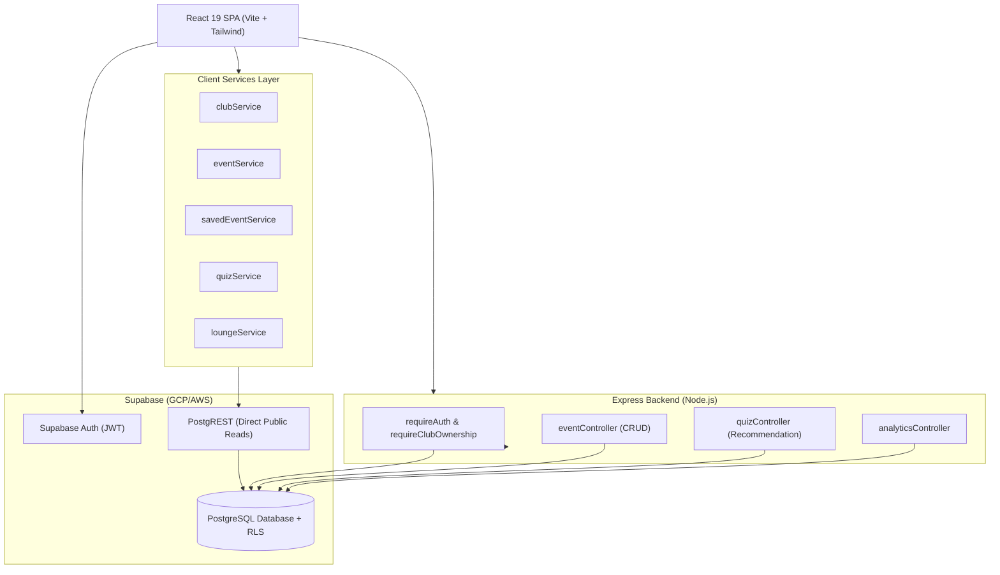

# CampusBuzz — System Architecture

## Architecture Diagram

## Core Architectural Decisions

### 1. Hybrid Client/Server Query Pattern
- **Public & High-Frequency Reads**: Direct client queries to Supabase via `@supabase/supabase-js`. RLS ensures users only read what is published.
- **Protected Actions & Server Business Logic**: Channeled through Express routes (`/api/events`, `/api/quiz/recommend`, `/api/analytics`), ensuring input validation, ownership assertions, and safe rate limiting.

### 2. Immediate Publishing
In collegiate event discovery, rapid iteration is paramount. Organizers publish events immediately with no administrative approval queue. Faculty admins retain oversight via an asynchronous moderation console with full revocation privileges.

### 3. Graceful Progressive Enhancement
Every frontend service checks `isSupabaseConfigured` and catches errors gracefully, falling back to local dataset defaults if the live database tables have not yet been populated or the network drops.
